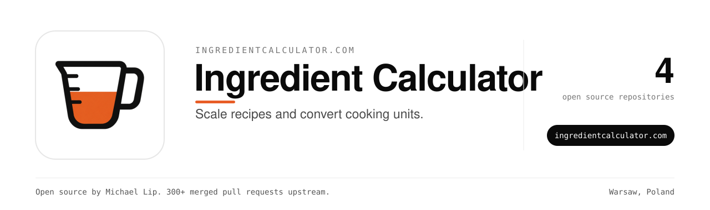

Scale recipes, convert cooking units, find substitutions and estimate nutrition. Free, no signup.

Use it at [ingredientcalculator.com](https://ingredientcalculator.com).

### Repositories

| Repository | What it does |
| --- | --- |
| [cup-density](https://github.com/ingredientcalculator/cup-density) | Grams-per-cup densities for 18 baking ingredients, cup/tbsp/tsp/mL to gram conversion (Python) |
| [cupful](https://github.com/ingredientcalculator/cupful) | Typst package: convert cup, tablespoon and teaspoon measures of common ingredients to grams |
| [ingredientcalculator](https://github.com/ingredientcalculator/ingredientcalculator) | recipe-ratio: recipe volume/weight conversion — source for the published crate |

### Maintainer

Built and maintained by [Michael Lip](https://github.com/theluckystrike) in Warsaw, Poland.
He also fixes bugs in projects he uses. He has 300+ merged pull requests in 200+ outside repositories, including [urllib3](https://github.com/urllib3/urllib3/pull/5330), [Appium](https://github.com/appium/appium/pull/22911), [Prefect](https://github.com/PrefectHQ/prefect/pull/21916) and [Google Chrome extension samples](https://github.com/GoogleChrome/chrome-extensions-samples/pull/1629).
Need an engineer for your own product or AI agent? Send a written brief at [axdale.com](https://www.axdale.com/?utm_source=github&utm_medium=org&utm_campaign=hire&utm_content=ingredientcalculator).
